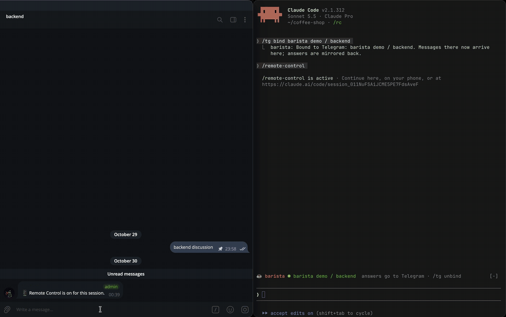
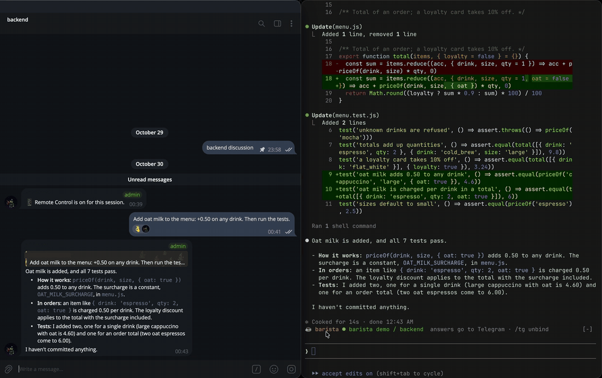
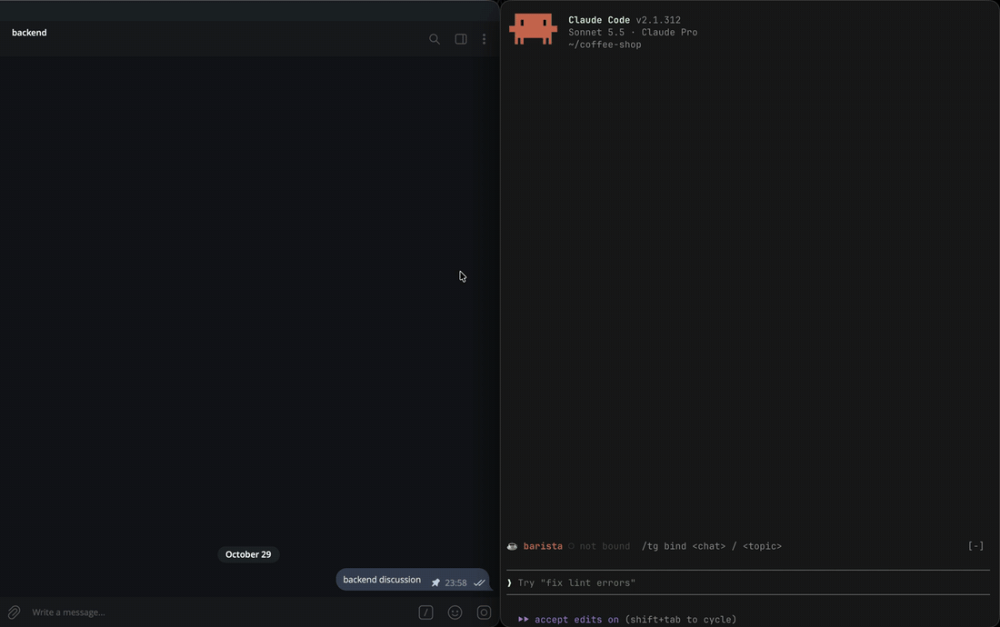
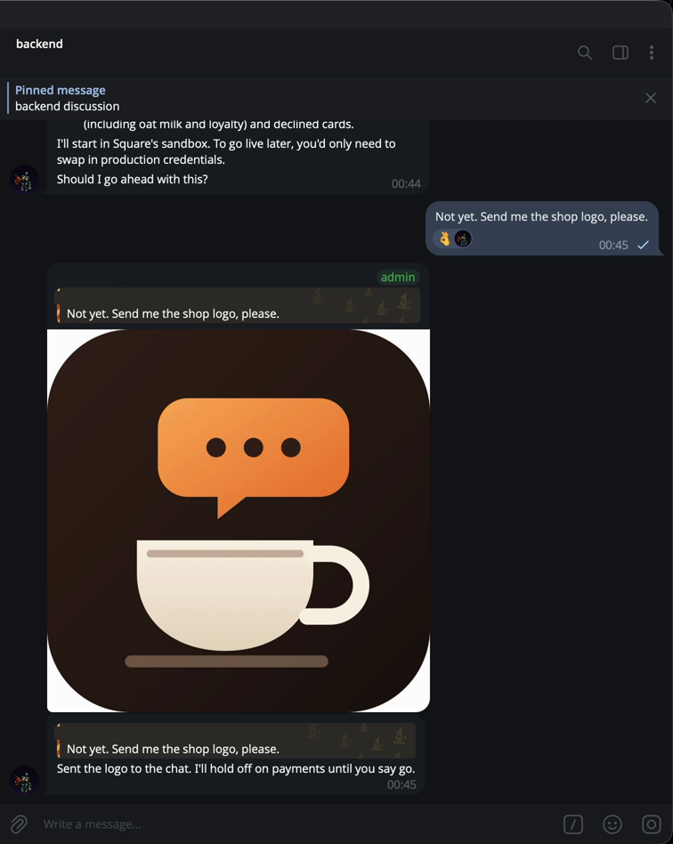
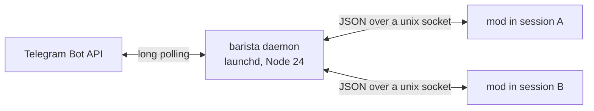

<div align="center">


# barista

**Talk to your Claude Code sessions from Telegram.**

Bind any running session to a Telegram chat or forum topic. Messages there become prompts, every answer comes back, and Claude can send you screenshots and files.


</div>

---

You start Claude Code on your Mac as usual, type `/tg bind Work / backend`, and leave the laptop open. From then on the *backend* topic in your *Work* group is a second prompt box for that session. Several sessions can listen to several topics at once, one bot for all of them.

```
you, in Telegram  ─▶  barista daemon  ─▶  Claude Code session  ─▶  answer back in the same topic
```

## See it work

A task sent from Telegram: the reactions follow its progress, each permission prompt posts a notice, and the answer comes back as a reply.



Claude asks a question: the options arrive as buttons, and a tap answers it in the terminal too.



<table>
<tr>
<td width="55%"></td>
<td></td>
</tr>
<tr>
<td>One command binds the session. The band above the prompt shows where it listens.</td>
<td>Claude sends files: screenshots, logs, documents.</td>
</tr>
</table>

## What you get

- One command per session to bind it: `/tg bind <chat> / <topic>`, or just ask Claude ("bind to topic backend in Work").
- Every final answer is mirrored to the topic, including answers to prompts you typed in the terminal. An answer to a Telegram message comes as a reply to it. Markdown, tables, code and links render natively in Telegram.
- Claude sends files when they say more than text: screenshots, videos, logs, documents, albums.
- You can send text, photos, videos, files, albums and voice messages. Voice is transcribed locally with whisper.cpp.
- Reactions show where each of your messages is:

  | | |
  |---|---|
  | 👀 | the session got it (it may still be busy) |
  | ✍ | Claude is working on it, and the topic shows "typing…" |
  | 🤔 | waiting for your permission |
  | 👌 | answered |
  | 🙈 | interrupted |
  | 💔 | failed (the reason follows as a message) |
  | 🤷 | message type not supported |

  No reaction means no session listens there right now; such messages are ignored.
- Binding also turns on Remote Control, so permission prompts can be answered from the Claude app on your phone. The topic gets a short notice with the session's Remote Control link; it is deleted when the question is settled and the call ends.
- Claude's questions arrive with a button per option; a tap answers them, and the terminal dialog closes.
- `/stop` in the topic interrupts the current turn. Replying to a specific message quotes it into the prompt.

## How it works



A Telegram bot token allows only one `getUpdates` poller, so one small daemon owns it and routes messages to sessions. Each Claude Code session runs the barista mod, which long-polls its own inbox, submits messages as prompts, and mirrors answers back. The daemon idles on a 50-second long poll, so it uses almost no CPU.

## Install

### 1. Prerequisites

| What | Why | How |
|---|---|---|
| macOS | the daemon runs as a launchd agent | |
| [Homebrew](https://brew.sh) | installs the tools below | see brew.sh |
| Node.js 24 or newer | runs barista | `brew install node` |
| Claude Code with mods support | barista is a Claude Code mod | [docs](https://code.claude.com/docs) |
| A claude.ai login in Claude Code | Remote Control needs it | `claude` → `/login` |
| ffmpeg + whisper.cpp (optional) | voice message transcripts | `brew install ffmpeg whisper-cpp` (setup offers this) |

### 2. Create the bot

1. In Telegram, open [@BotFather](https://t.me/BotFather), send `/newbot`, pick a name and a username. Copy the token.
2. Let the bot read group messages. Either make it an admin in each group, or send `/setprivacy` to @BotFather, pick the bot and choose **Disable**.
3. For a group with topics: enable Topics in the group settings and give the bot the admin right **Manage Topics**, so it can create topics for you.

### 3. Install barista

From a release tarball:

```sh
npm install -g ./barista-1.0.0.tgz
```

Or from source:

```sh
git clone https://github.com/LuminiteTime/barista.git && cd barista
npm install -g .
```

There is no build step: from a checkout, Node 24 runs the TypeScript sources directly. Keep the folder, the global `barista` links to it.

### 4. Run setup

```sh
barista setup
```

It asks for the bot token (input hidden), then waits until you send `/start` to the bot in a private chat (that is how it learns your Telegram user id; only you can talk to your sessions). Coming from the official Telegram plugin, it takes both from `~/.claude/channels/telegram/` and asks nothing. Then it offers to install the voice tools, starts the daemon as a launchd agent, installs the Claude Code mod, and runs the `barista doctor` checks.

Optional flags: `--token-file <path>` (the bare token or an `.env` line; there is no `--token`, since `ps` and shell history would show it), `--owner <your user id>`, `--chats <id,id>` (read only these chats; the bot learns them at start, so binding by name works right away), `--yes`, `--no-voice`, `--no-mod`.

Setup ends with the same checks `barista doctor` runs any time later: every line is ✓ or ✗ with the exact fix. Turn off the official Telegram plugin if you had it (`claude plugin disable telegram@claude-plugins-official`): one bot token allows one poller.

### 5. Bind a session

Restart any open Claude Code sessions so they load the mod, then in one of them:

```
/tg bind Work / backend
```

The bot only knows chats and topics it has seen in messages (Telegram has no way to list topics). If it answers `CHAT_UNKNOWN`, send any message in the chat or bind by its numeric id. On `TOPIC_UNKNOWN`, send any message in that topic and retry, or add `--create` to create it. `/tg bind me` uses the private chat with the bot.

## Commands

| In Claude Code | |
|---|---|
| `/tg bind <chat> [/ <topic>] [--create] [--force]` | bind this session (`--force` takes a topic from another live session) |
| `/tg unbind` | stop listening |
| `/tg status` | where this session is bound |

| In Telegram | |
|---|---|
| `/stop` | interrupt the running turn |

| In a terminal | |
|---|---|
| `barista setup` | install or reconfigure |
| `barista doctor` | check everything |
| `barista status` | daemon health and which session listens where |
| `barista logs` | follow the daemon log |
| `barista start` / `stop` | control the daemon |
| `barista uninstall [--purge]` | remove the agent and the mod (`--purge` also deletes `~/.barista`) |

## Troubleshooting

| Code | Meaning | Fix |
|---|---|---|
| `DAEMON_DOWN` | the mod cannot reach the daemon | `barista start`, then `barista logs` |
| `NOT_CONFIGURED` | no token or owner | `barista setup` |
| `CHAT_UNKNOWN` | the bot has not seen that chat | add the bot, send any message there, or bind by chat id |
| `TOPIC_REQUIRED` | the chat has topics; bind one | `/tg bind <chat> / <topic>` |
| `TOPIC_UNKNOWN` | the bot has not seen that topic | send a message in it, or use `--create` |
| `NOT_FORUM` | a topic was given for a chat without topics | bind the chat alone |
| `TOPIC_TAKEN` | another live session listens there | unbind it, or `--force` |
| `NO_RIGHTS` | Telegram refused to create a topic | give the bot "Manage Topics" |
| `FILE_TOO_BIG` | over Telegram's bot limits (20 MB in, 50 MB out); the rest of a batch still goes | compress or split the file |
| `TG_API` | Telegram rejected a request | the message carries Telegram's reason |

If messages in a group never get a 👀, the bot probably cannot read them: make it an admin or disable privacy mode. A repeated 409 warning in the log means another program polls the same token (an old script, another bot framework, the official Telegram plugin); one token allows one poller.

Everything barista keeps is in `~/.barista`: `config.json` (token, mode 600), `state.json`, received `files/` (kept 7 days), `daemon.log` (rotated at 5 MB). Bindings of sessions unseen for 30 days are forgotten.

## Development

```sh
npm ci
npm run check       # lint (file and function size limits), typecheck, tests, build
npm run check:mod   # validate, test and typecheck the mod (needs the claude CLI)
```

The code is in three parts. `src/daemon` is the Telegram side: Bot API client, poller, chat registry, bindings, inbound and outbound messages, socket API. `src/cli` holds `barista` and its launchd setup. `mod/hooks` is the Claude Code side; `mod/hooks/protocol.ts` is the contract between the two. More in the [docs](docs/docs/): `cd docs && npm ci && npm start`.

## License

MIT
