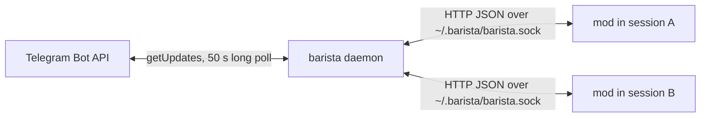

# Architecture

## Daemon

One Node 24 process under launchd (`dev.barista.daemon`), with no runtime dependencies. A bot token allows a single poller, so the daemon owns it and routes updates.

- **Registry** remembers chats and topics seen in updates and resolves `chat / topic` names.
- **Bindings** map a target (chat, topic) to one session id. A binding stays live while its session polls; after 60 s of silence another session can take it.
- **Delivery** filters updates (owner only, optional chat allowlist), groups albums, downloads files, transcribes voice and queues the message in the session's inbox.
- **Replies** send rich text with a plain fallback, files and albums, reactions and permission notices. An answer carries `replyTo`, the Telegram message it answers, and goes out as a reply to it.
- **Housekeeping** runs at start and hourly: received files older than 7 days, bindings unseen for 30 days, and a `daemon.log` over 5 MB (copied to `daemon.log.1`, then emptied in place, since launchd holds it open).
- **State** (`~/.barista/state.json`) keeps the update offset, registry, bindings and open notices, written atomically. Notices left by sessions that died are deleted on the next start.

## Mod

A Claude Code hooks module loaded in every session. It registers the `/tg` command, four tools for Claude (`telegram_bind`, `telegram_unbind`, `telegram_send_files`, `telegram_status`) and a system prompt section while bound. Once a second it long-polls the session inbox and submits messages as prompts. It reports stages (queued, working, waiting, done) as reactions, mirrors each final answer, and opens and closes permission notices around `PermissionRequest`.

All mod logic depends on a small `Io` port built in `session.start`, which keeps it testable outside the engine.

## Protocol

`mod/hooks/protocol.ts` is the contract between the two parts.

| Route | Purpose |
|---|---|
| `GET /health` | version, bot username, privacy mode |
| `GET /chats`, `GET /bindings` | what the bot knows, who listens where |
| `POST /attach` | session start; moves a binding after `/clear` |
| `POST /bind`, `POST /unbind` | change the binding |
| `GET /inbox?sessionId&wait` | long poll for messages (up to 25 s) |
| `POST /send`, `POST /send-files` | answer text, files |
| `POST /status` | reaction for a stage |
| `POST /notice`, `POST /notice/close` | permission notice |

Errors are `{ error: { code, message, hint } }` with HTTP 400 (or 500 for bugs).
